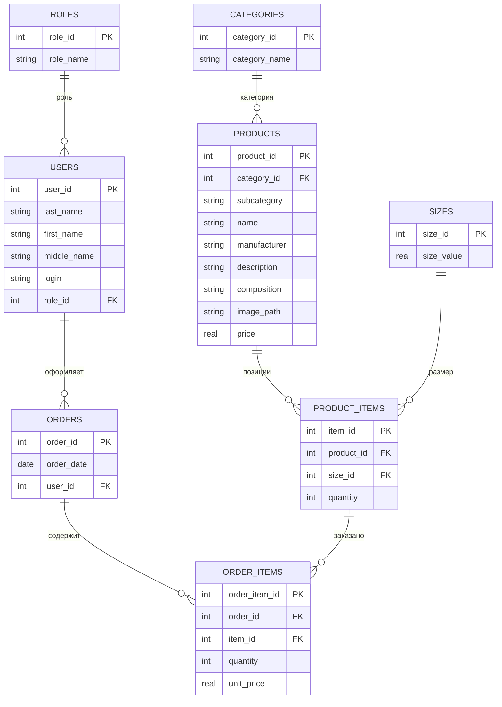

# ER-диаграмма «Чудо Обувь» (8 таблиц)

Скопируй код ниже в **mermaid.live** или в **draw.io**:
`Extras → Edit Diagram → вставить Mermaid → Apply`, затем
`File → Export as → PDF`.

## Чек-лист перед экспортом

- [ ] все 8 таблиц;
- [ ] атрибуты;
- [ ] PK и FK;
- [ ] связи 1:M;
- [ ] согласованные имена;
- [ ] экспорт **в PDF** (не PNG);
- [ ] проверить, что текст читается при 100% масштабе.

## Вариант без Mermaid

В draw.io: ` Arrange → Insert → From Text` не нужен — просто нарисуй 8
прямоугольников, подпиши поля, соедини линиями и подпиши связи «1» и «M».
Главное — чтобы эксперт увидел таблицы, атрибуты, ключи и связи.
