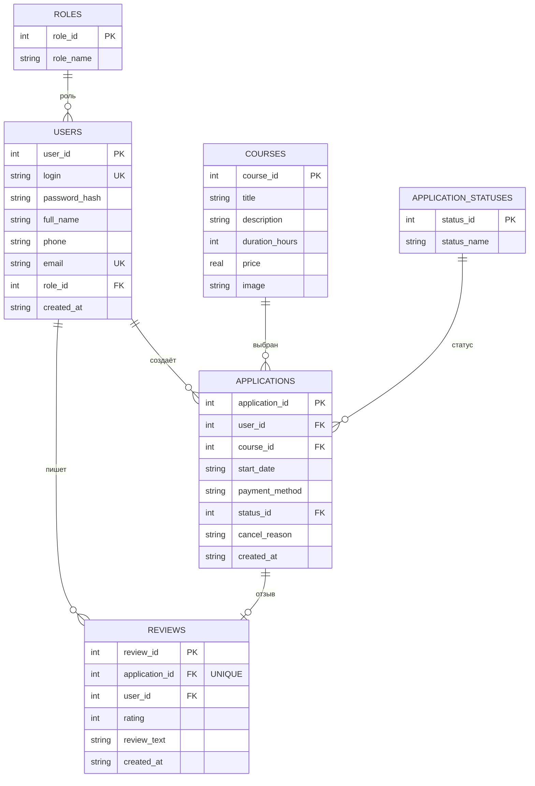

# ER-диаграмма «Корочки.есть» (6 таблиц)

Скопируй код в **mermaid.live** или в **draw.io**
(`Extras → Edit Diagram → вставить Mermaid → Apply`),
затем `File → Export as → PDF`.

## Что проверить на защите

- 6 таблиц, 3НФ;
- PK/FK, `UNIQUE` на `login`, `email`, `reviews.application_id`;
- `CHECK` на оплату и рейтинг;
- кардинальности `1` и `M`;
- подписи связей;
- PDF/PNG приложен к README.
