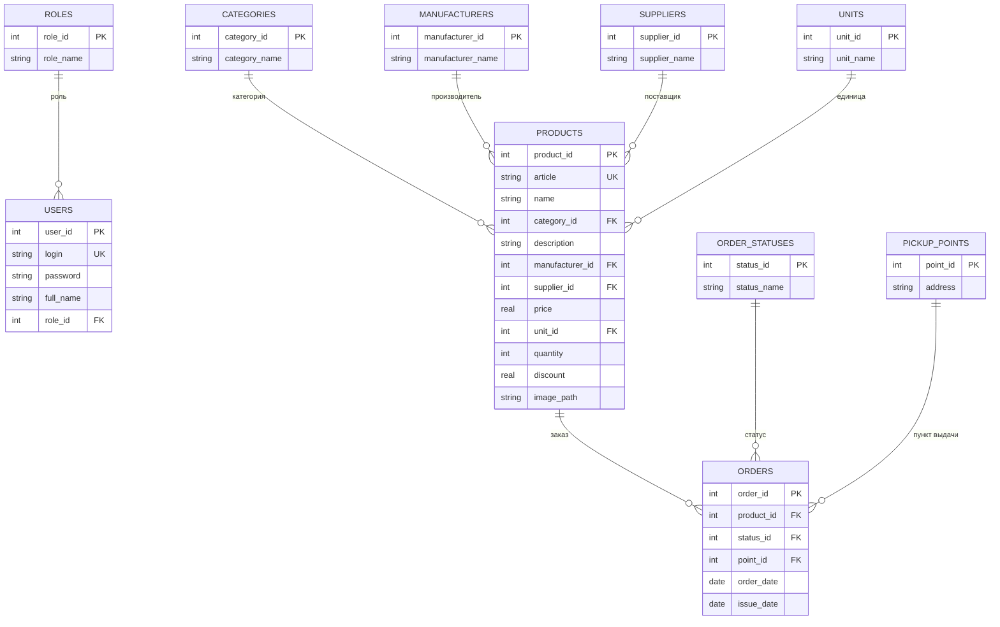

# ER-диаграмма «Магазин обуви» (09.02.07-2, КОД 2026)

Скопируй код в **mermaid.live** или **draw.io**
(`Extras → Edit Diagram → вставить Mermaid → Apply`),
затем `File → Export as → PDF`.

## Что проверить

- 10 таблиц, 3НФ;
- PK/FK и `UNIQUE(article)`;
- `CHECK(price >= 0)`, `CHECK(quantity >= 0)`, `CHECK(discount 0..1)`;
- кардинальности `1` и `M`;
- PDF приложен к README.
