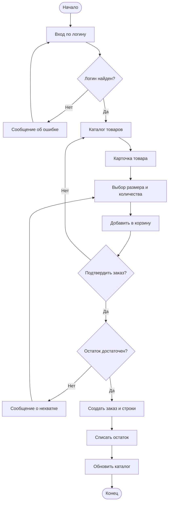
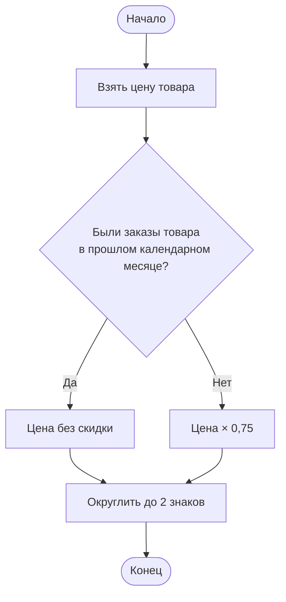

# Блок-схемы к Заданию 2 (ГОСТ 19.701-90)

Нужны **два алгоритма**. Вставь код в **mermaid.live** (или draw.io:
`Extras → Edit Diagram → Mermaid`) и экспортируй в **PDF**.

## 1. Оформление заказа

## 2. Расчёт цены со скидкой 25%

## Обозначения по ГОСТ 19.701-90

| Символ | Значение |
|---|---|
| овал | начало / конец |
| прямоугольник | процесс (действие) |
| ромб | решение, выходы «Да» / «Нет» |
| параллелограмм | ввод / вывод |
| стрелка | направление потока |

## Частые ошибки

- нет «Начало»/«Конец»;
- у ромба нет подписей «Да»/«Нет»;
- нет второго алгоритма (скидки);
- экспорт в PNG вместо PDF;
- текст не читается.
