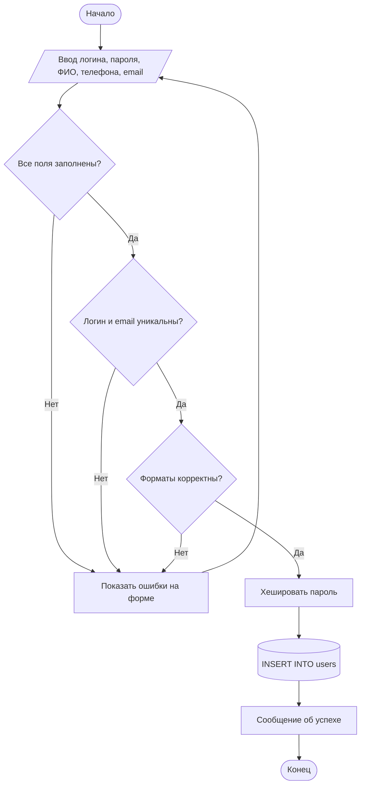
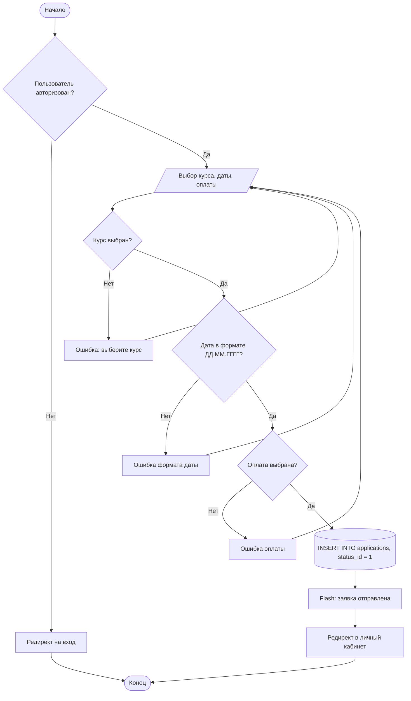
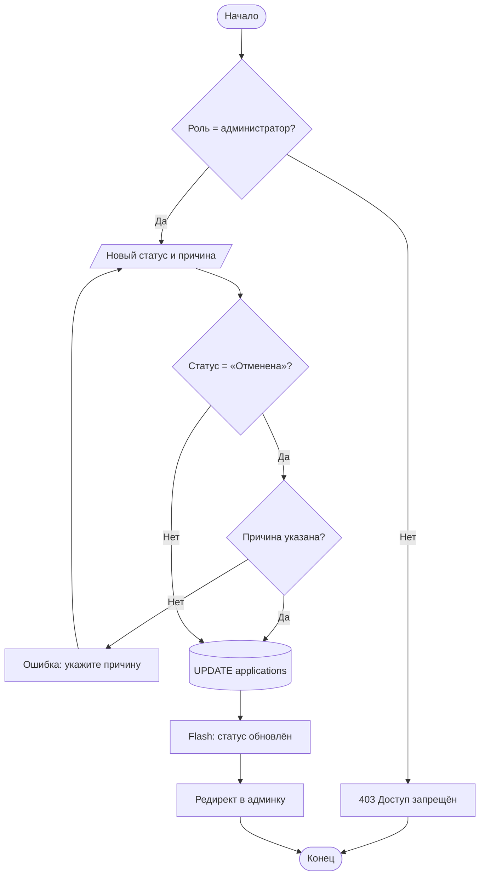

# Блок-схемы (ГОСТ 19.701-90)

Нужны три алгоритма. Вставь код в **mermaid.live** (или draw.io:
`Extras → Edit Diagram → Mermaid`) и экспортируй в **PDF**.

## 1. Регистрация

## 2. Создание заявки

## 3. Смена статуса администратором

## Оформление

- овал — начало/конец;
- прямоугольник — процесс;
- ромб — условие (Да/Нет);
- параллелограмм — ввод/вывод;
- цилиндр — база данных;
- линии со стрелками, подписи «Да»/«Нет».
