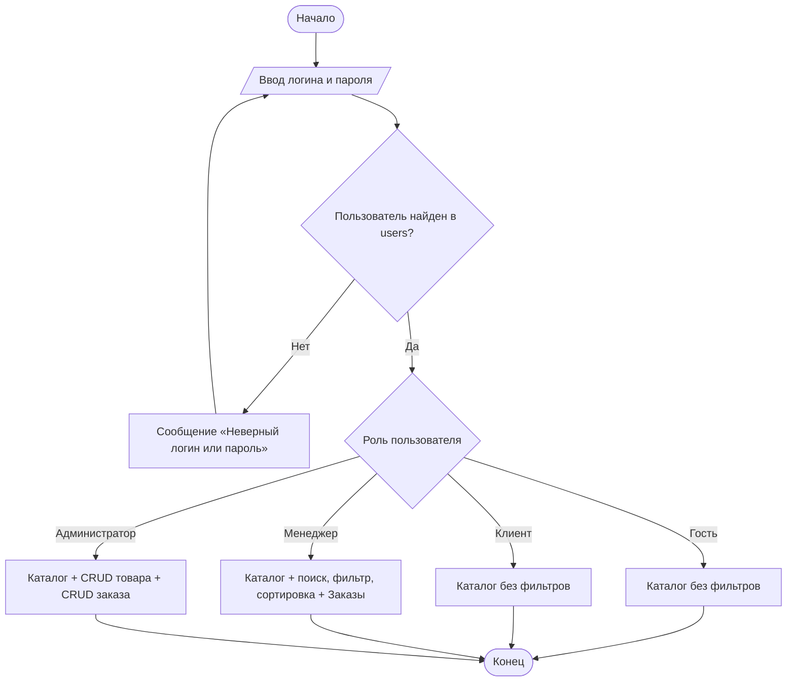
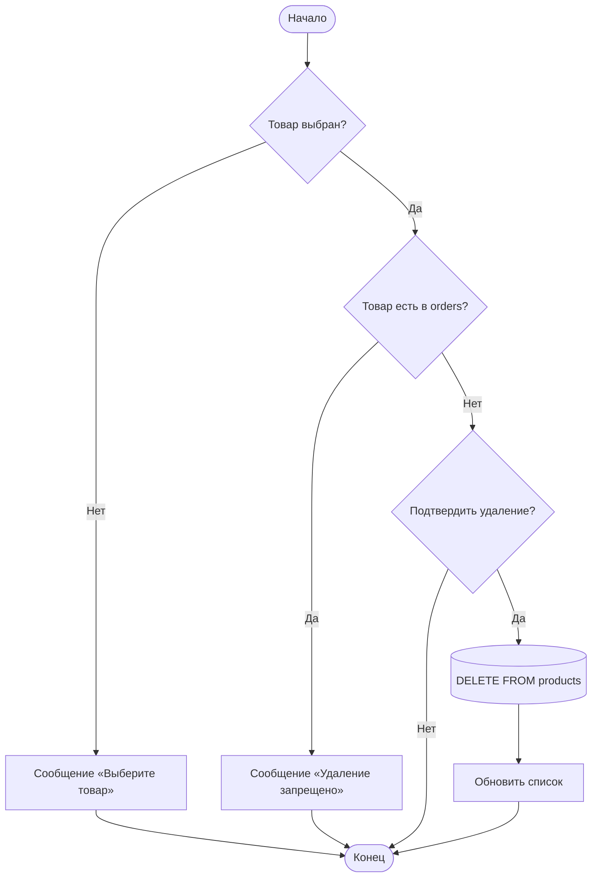

# Блок-схемы «Магазин обуви» (09.02.07-2, КОД 2026)

Нужна блок-схема по ГОСТ 19.701-90 в PDF. Вставь код в **mermaid.live**
или draw.io (`Extras → Edit Diagram → Mermaid`) и экспортируй в PDF.

## 1. Вход в систему



## 2. Добавление / редактирование товара

```mermaid
flowchart TD
    A([Начало]) --> B[Открыть форму товара]
    B --> C[/Ввод полей: артикул, наименование, категория, описание, производитель, поставщик, цена, единица, количество, скидка, фото/]
    C --> D{Артикул и наименование заполнены?}
    D -- Нет --> E[Сообщение об ошибке] --> C
    D -- Да --> F{Цена ≥ 0, количество ≥ 0, скидка 0..100?}
    F -- Нет --> E
    F -- Да --> G{Редактирование?}
    G -- Нет --> H[ID = MAX(product_id) + 1]
    H --> I[(INSERT INTO products)]
    G -- Да --> J[(UPDATE products)]
    I --> K[Обновить список товаров]
    J --> K
    K --> Z([Конец])
```

## 3. Удаление товара



## Оформление

- овал — начало/конец;
- прямоугольник — процесс;
- ромб — условие («Да»/«Нет»);
- параллелограмм — ввод/вывод;
- цилиндр — база данных;
- подписи и стрелки обязательны.
